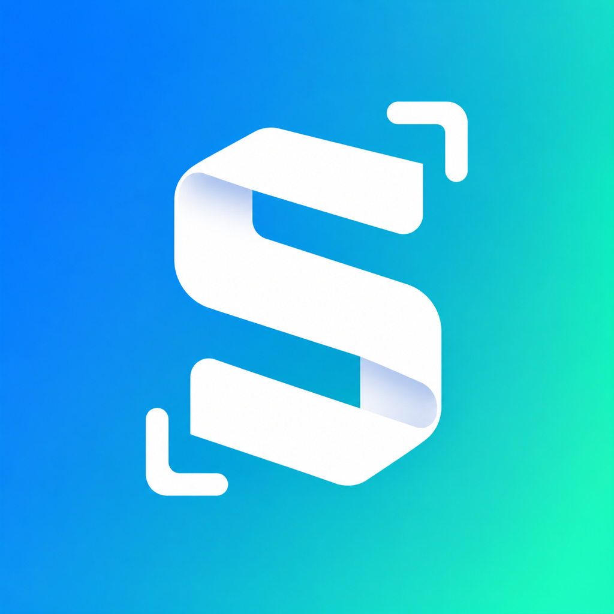
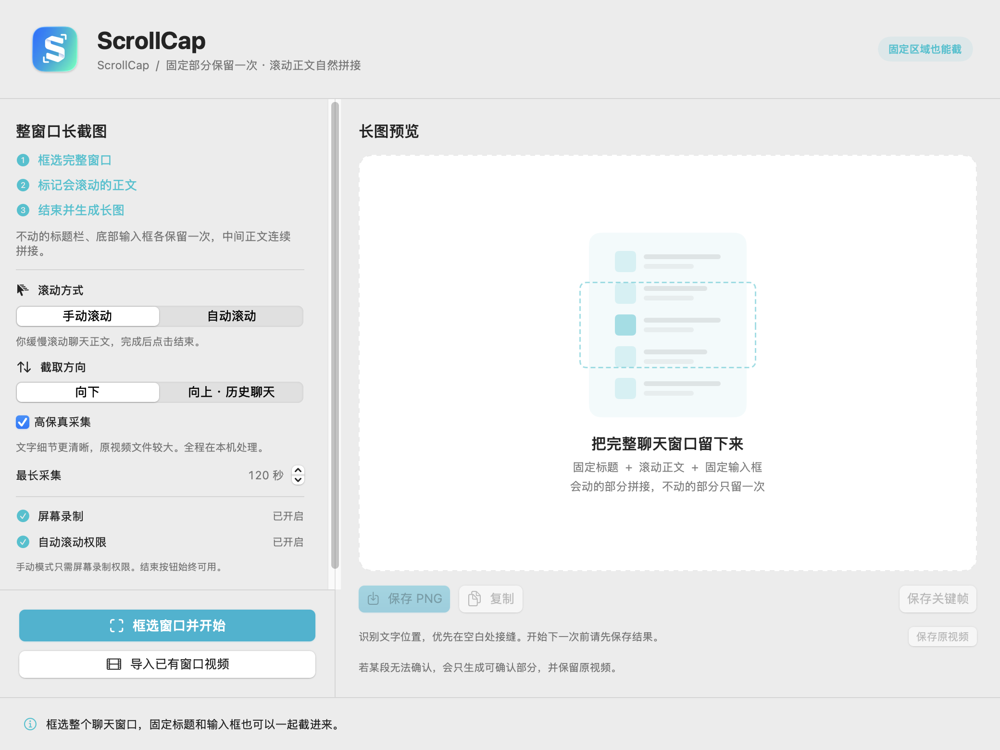
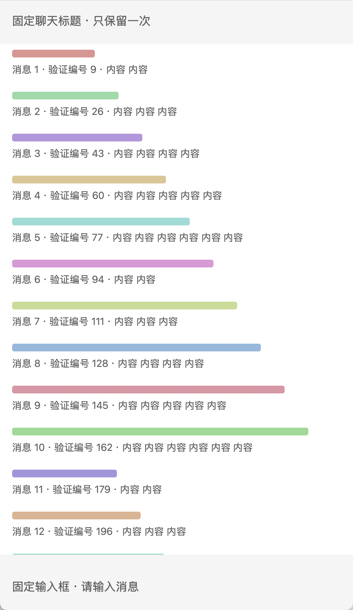

<div align="center">



# ScrollCap · 长截图

**把完整对话框，留在一张长图里。**

固定标题与输入框各保留一次，滚动正文连续拼接。

[](#安装)
[](#从源码构建)
[](LICENSE)
[](https://github.com/arronfan23/scrollcap/actions/workflows/ci.yml)

[下载安装包](https://github.com/arronfan23/scrollcap/releases/latest) · [使用指南](docs/USER_GUIDE.zh-CN.md) · [English](README.en.md) · [反馈问题](https://github.com/arronfan23/scrollcap/issues/new/choose)

</div>

---

ScrollCap 是一款原生 macOS 长截图工具，适合网页、聊天记录和带固定标题栏的窗口。先连续采集滚动画面，再选择清晰帧、匹配重叠内容，并用 Apple Vision 识别文字位置，优先在空白处接缝。全部处理在本机完成。



## 功能

| 功能 | 使用场景 |
| --- | --- |
| 完整窗口截图 | 保留固定顶部标题、底部输入框，中间正文拼成长图 |
| 手动 / 自动滚动 | 手动模式只需屏幕录制权限；自动模式支持缓慢连续滚动 |
| 向上 / 向下采集 | 向上整理历史聊天，向下截取网页和文档 |
| 视频导入 | 将已有滚动视频转成长截图，无需屏幕录制权限 |
| 本机文字识别 | Apple Vision 辅助选择接缝，文字保留原始画面像素 |
| PNG 与原始记录导出 | 保存长图、复制到剪贴板，或导出视频、关键帧和分析报告 |

## 安装

1. 在 [Releases](https://github.com/arronfan23/scrollcap/releases/latest) 下载与你的 Mac 匹配的安装包。
2. 打开 DMG，将 **ScrollCap.app** 拖入 **Applications** 后启动。
3. 在系统设置中开启 **ScrollCap** 的屏幕录制权限。开启后退出并重新打开应用，让当前进程读取最新授权。

从旧版「长截图2」迁移时，请给新应用 **ScrollCap** 单独授权。

需要 macOS 14 或更新版本。下载时按设备选择：

| Mac 类型 | 安装包 |
| --- | --- |
| Apple 芯片 | `ScrollCap-2.1.0-macOS-arm64.dmg` |
| Intel | `ScrollCap-2.1.0-macOS-x86_64.dmg` |

发布包使用本地签名，尚未进行 Apple Developer ID 签名与公证。

> 自动滚动还需要辅助功能权限。手动滚动及视频导入都不需要辅助功能权限。

## 30 秒上手

**框选整个对话框 → 标记正文 → 缓慢滚动 → 结束 → 保存 PNG**

框选时包括顶部标题和底部输入框。在预览中拖动上下两条线，让中间只包含会滚动的正文，并勾选「把固定部分截进长图」。确认后保持窗口位置和大小不变，缓慢滚动，完成后点击浮动条上的「结束并生成」。

<details>
<summary>查看实际录制生成的长图示例</summary>

下图来自专用测试窗口，顶部标题与底部输入框各出现一次。



</details>

## 使用范围与限制

- 固定区域目前通过两条水平边界定义；框选时请避开固定的左侧会话列表。
- 正文中的悬浮弹窗、遮挡层不能单独分离。过快滚动或拖动滚动条跳过内容可能导致拼接中断。
- 遇到无法确认的重叠内容时，应用提示并保留已确认部分，不补写缺失文字。
- 录制可设为 30–300 秒，视频约 2 GB 时停止；长图上限为 4000 万像素，正文高度不超过 60000 像素。
- 开始下一次或退出前，请保存需要的结果；临时采集文件会清理。

## 权限已开，仍提示开启？

确认授权的是 **Applications 中的ScrollCap**，然后**完全退出并重新打开**。当前运行进程可能保留旧的授权状态，这个方法已在实际使用中验证。

重新编译或更新本地签名版本后，macOS 也可能要求重新授权。详见 [权限排查](docs/USER_GUIDE.zh-CN.md#权限已开启却未识别)。

## 从源码构建

安装 Xcode Command Line Tools 或 Xcode，随后在 macOS 上运行：

```sh
git clone https://github.com/arronfan23/scrollcap.git
cd scrollcap
./scripts/build.sh
open dist/ScrollCap.app
```

也可以双击根目录的 `build.command`。构建默认使用当前机器架构；交叉构建可指定 `SCROLLSHOT_ARCH=arm64` 或 `SCROLLSHOT_ARCH=x86_64`。无需第三方运行时、云端 API 密钥或 Swift 包依赖。

```sh
./scripts/test.sh                 # 构建并运行 15 项基础检查、21 项视频检查
./scripts/package.sh --no-build  # 生成 DMG、应用 ZIP 和 SHA-256 校验文件
```

## 项目结构

```text
Sources/ScrollCap/  原生界面、录制、拼接与自测入口
Resources/          应用元数据和 macOS 图标
scripts/            构建、验证与打包脚本
docs/               使用说明、架构说明和展示素材
.github/            持续集成、贡献规范和问题模板
```

采集使用 ScreenCaptureKit；视频编解码使用 AVFoundation；文字与配准使用 Apple Vision。了解处理流程，请看 [架构说明](docs/ARCHITECTURE.md)。

## 参与改进

欢迎提交 Issue 和 Pull Request。请先阅读 [贡献指南](CONTRIBUTING.md)，反馈问题时说明 macOS 版本、设备架构、滚动方向和复现步骤。涉及聊天内容的素材请先脱敏。

## 隐私与许可证

应用没有账号系统、云端上传、统计或遥测，处理无需联网。原始视频、关键帧与识别结果留在本机，详见 [隐私说明](docs/PRIVACY.md)。

代码按 [MIT License](LICENSE) 发布。Logo 的设计与导出说明见 [品牌素材](docs/brand/README.md)。
