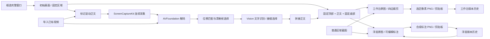

# Architecture

ScrollCap 是原生 macOS 应用，通过 shell 脚本直接编译 Swift 源码。运行时使用系统框架，没有第三方包依赖。

## 模块

| 文件 | 职责 |
| --- | --- |
| `App.swift` | SwiftUI 工作台 / 历史切换、菜单、HUD 和应用生命周期 |
| `CaptureModel.swift` | 权限、会话状态、录制、导入、导出与取消 |
| `AppPreferences.swift` / `AppSettingsView.swift` | 本机偏好、快捷键录入、普通截图自动置顶和历史保存方式 |
| `GlobalHotKeys.swift` | Carbon 全局快捷键注册、冲突处理、录入时暂停及退出清理 |
| `PinnedScreenshot.swift` | 原位置截图浮层、图标工具栏、置顶、缩放、标注导出与历史更新 |
| `ScreenshotCanvas.swift` | 任意位置移动、标注手势、选择移动、文字输入与键盘交互 |
| `ScreenshotAnnotations.swift` | 原始像素坐标的标注模型、撤销重做、合成渲染与马赛克 |
| `ScreenshotHistory.swift` | 本机历史存储、原图与标注序列化、缩略图、记录更新、损坏隔离和移到废纸篓 |
| `ScreenshotHistoryView.swift` | 历史缩略图列表、元信息、重新编辑、复制、导出与删除入口 |
| `RegionPicker.swift` | 屏幕选区、目标应用及窗口位置选择 |
| `AutoScroll.swift` | 小步滚动、到底检测、窗口 / 前台 / 鼠标检查、可取消滚动和新进程权限读取 |
| `ChromePicker.swift` | 全窗口预览上的两条正文边界 |
| `ImageCrop.swift` | AppKit 裁剪预览、四边 / 四角交互、缩放与像素坐标转换 |
| `VideoRecorder.swift` | SCStream 输出与 AVAssetWriter 写入 |
| `VideoEngine.swift` | 解码、关键帧、位移追踪、OCR、接缝与报告 |
| `Stitcher.swift` | 灰度采样、重叠匹配、图像组装与 PNG 输出 |
| `SelfTests.swift` / `CropTests.swift` / `VideoTests.swift` | 合成素材和命令行检查 |
| `HistoryTests.swift` | 隔离目录中的持久化、标注恢复、更新失败与删除边界检查 |

## 画面处理

普通截图使用 ScreenCaptureKit 直接获取所选区域并保留原始像素尺寸，进入与长截图共用的裁剪和导出流程。两种结果均可把当前裁剪的 CGImage 快照交给独立 NSPanel；新采集或再次裁剪不会改变已置顶的图片。

工作台维护原图与裁剪选区，浮层维护独立的 `ScreenshotDocument` 和标注。工作台裁剪导出与浮层标注导出各自使用独立历史身份，避免保存工作台原图时覆盖浮层已经保存的标注版本；从历史再次编辑则沿用该条记录的 UUID。

正文使用原始视频帧像素。按原始高度对相邻帧进行全范围像素匹配，再精细验证；文字对空白的不一致也计入误差，不剔除包含区分性文字的行。自动模式根据控制器的滚轮速度和帧时间约束最大位移，避免把重复分隔线认成大幅滚动。分析每个编码帧，避免固定抽帧跳过快速滚动时的重叠画面。累计位移达到阈值时选择清晰帧，大步幅前先保留上一帧作为桥接，再验证关键帧之间的对齐。

Vision OCR 标记文字区域，接缝代价计算尽量避开文字框和强烈边缘。输出不混合、重绘或生成文字。标记的固定区域会与录制中多个时刻的画面对比；确认它们随页面移动时，自动扩入正文并显示修正提示。保留的固定顶部和底部来自初始画面，各组装一次。若无法确认连续覆盖，输出已确认部分并附警告。

## 历史与文档生命周期

默认「保存/复制后保留」只在用户成功保存或复制后写入历史，未保留的新截图直接 Esc 或关闭会被丢弃。「所有截图自动保留」在采集结果生成后创建记录，并在关闭这张新截图时写入最终标注。历史重新编辑使用上次保存的原图与标注，撤销栈从该版本开始；保存图标、Command + S 和复制更新原条记录，Option + Command + S 导出 PNG。Esc 丢弃这次未提交的编辑，历史上次版本不变。

生产应用的历史根目录为 `~/Library/Application Support/ScrollCap/History`，设计预览使用独立的 `ScrollCap Design Preview/History`，测试注入临时根目录和删除操作。每条记录以 UUID 为目录名，保存原始 PNG、合成预览、缩略图、标注 JSON 和带版本号的元信息。标注使用原始像素坐标，保存工具类型、点位、sRGB 颜色、粗细、文字和字号。

更新先完整写入新修订目录，再原子替换 `current.json` 指针，成功后清理旧修订；写入失败保留上次提交的记录。扫描按条目隔离错误，损坏记录显示错误提示，不阻止健康记录继续使用。记录按更新时间排序，修改同一 UUID 不新增重复项。

删除通过 `FileManager.trashItem` 将整个历史条目移到系统废纸篓，失败时保留原条目与文件；全部删除逐条处理并报告失败。导出的文件位于用户选择的位置，不属于历史删除范围。历史为再次编辑保留原图，因此马赛克遮挡可以移除；PNG 与剪贴板图片由渲染器合成为像素图，不附带原图或可编辑图层。

## 验证与边界

基础检查验证重复帧、位移与拼接。裁剪检查验证四边和四角、选区移动、边界限制、原始像素和 PNG 导出，以及完成 / 继续编辑 / 恢复和下一次采集的状态。视频检查包含中文文字、固定标题 / 输入框、上下方向、最后一帧、缺失重叠和取消处理。历史检查覆盖重启恢复、完整标注往返、原像素保留、同条更新、损坏隔离、提交失败回滚和不触碰外部导出文件。检查无需实际屏幕权限；真实窗口录制与界面交互需由用户授予系统权限后单独验证。

当前固定区域限定在正文上方和下方。为约束内存，关键帧图像写入本机文件，组装时逐条读取；输出设置像素与高度上限。
