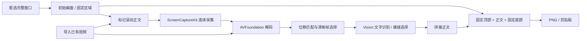

# Architecture

ScrollCap 是原生 macOS 应用，通过 shell 脚本直接编译 Swift 源码。运行时使用系统框架，没有第三方包依赖。

## 模块

| 文件 | 职责 |
| --- | --- |
| `App.swift` | SwiftUI 主界面、菜单、HUD 和应用生命周期 |
| `CaptureModel.swift` | 权限、会话状态、录制、导入、导出与取消 |
| `RegionPicker.swift` | 屏幕选区与目标应用选择 |
| `ChromePicker.swift` | 全窗口预览上的两条正文边界 |
| `VideoRecorder.swift` | SCStream 输出与 AVAssetWriter 写入 |
| `VideoEngine.swift` | 解码、关键帧、位移追踪、OCR、接缝与报告 |
| `Stitcher.swift` | 灰度采样、重叠匹配、图像组装与 PNG 输出 |
| `SelfTests.swift` / `VideoTests.swift` | 合成素材和命令行检查 |

## 画面处理

正文使用原始视频帧像素。先通过低成本灰度匹配估计相邻帧移动，再精细验证；需要时使用 Vision 平移配准辅助判断。累计位移达到阈值时选择清晰帧，再验证关键帧之间的对齐。

Vision OCR 标记文字区域，接缝代价计算尽量避开文字框和强烈边缘。输出不混合、重绘或生成文字。固定顶部和底部来自初始画面，各组装一次。若无法确认连续覆盖，输出已确认部分并附警告。

## 验证与边界

基础检查验证重复帧、位移与拼接。视频检查包含中文文字、固定标题 / 输入框、上下方向、最后一帧、缺失重叠和取消处理。检查无需实际屏幕权限；真实窗口录制需由用户授予系统权限后单独验证。

当前固定区域限定在正文上方和下方。为约束内存，关键帧图像写入本机文件，组装时逐条读取；输出设置像素与高度上限。
